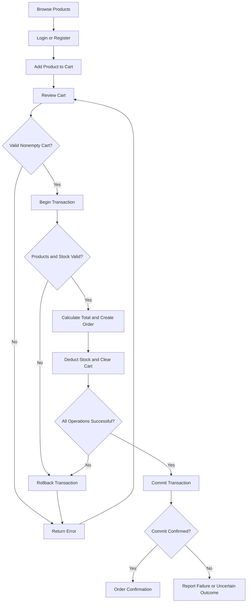

# GoShop — MVP Scope

## 1. Project Purpose

GoShop is a learning-oriented, single-store e-commerce application built with Go.

The main objective is to learn backend development by implementing the fundamental features of an online technology accessories store.

The project prioritizes simplicity, maintainability, security, and incremental development.

## 2. User Roles

### Guest

A guest is an unauthenticated visitor, not a stored user role.

- Browse available products.
- Search and filter products.
- View product details.
- Register or log in.

### Customer

- Access guest browsing functionality.
- Manage their shopping cart.
- Place simulated orders.
- View their own order history and order details.
- Log out.

### Admin

- Log in and log out.
- Create and update products.
- Manage product prices and stock.
- Activate or deactivate products.
- View all orders.
- Update order statuses.

## 3. Customer Flow

1. Browse available products.
2. Search or select a product.
3. Register or log in if not already authenticated.
4. Add products to the shopping cart.
5. Review cart items, quantities, and total.
6. Confirm checkout.
7. Receive an order confirmation if checkout succeeds, or an error if it fails.
8. View order history.

## 4. Admin Flow

1. Log in as an administrator.
2. Access the administration dashboard.
3. Create or update products.
4. Manage product prices and stock.
5. Review customer orders.
6. Update order statuses.

## 5. MVP Features

- Product catalog and product details
- Product search, filtering, sorting, and pagination
- Product categorization
- User registration and authentication
- Role-based authorization
- Shopping cart
- Inventory management
- Simulated checkout
- Order history
- Basic administration dashboard
- Simple web interface
- PostgreSQL persistence
- Automated testing

## 6. Out of Scope

- Real payment processing
- Credit card storage
- Shipping provider integration
- Multi-vendor marketplace
- Mobile applications
- Recommendation systems
- Microservices
- Advanced analytics
- Dedicated category administration interface

## 7. Core Domain Models

| Entity | Responsibility |
| --- | --- |
| User | Represents a customer or administrator. |
| Category | Organizes products into groups. |
| Product | Represents a product in the store. |
| CartItem | Represents a product and quantity in a customer's cart. |
| Order | Represents an order created through successful checkout. |
| OrderItem | Stores purchased product details, quantities, and purchase-time prices. |
| Session | Represents an authenticated user session. |

### Entity Relationships

- A category can contain multiple products; each product belongs to one category.
- A user can have multiple cart items and each cart item belongs to one user.
- A user can place multiple orders.
- A user can have multiple sessions.
- An order contains one or more order items.
- A product can appear in multiple cart items.
- A product can appear in multiple order items.

These are conceptual relationships. The physical database schema will be designed in later milestones.

## 8. Business Rules

- Product prices must be positive.
- Monetary values must be represented using integer minor currency units (kuruş for TRY).
- Product stock cannot be negative.
- Cart item quantities must be positive integers.
- Each product can appear only once in a customer's cart; adding the same product again increases its quantity.
- Inactive products cannot be purchased or displayed in the public catalog.
- Adding a product to the cart does not reserve stock.
- Product prices used for checkout must come from the server-side catalog, and order totals must be calculated on the server.
- Empty carts cannot be checked out.
- Product availability, stock, quantities, and current prices must be revalidated during checkout.
- Insufficient stock must prevent order creation.
- Order creation, stock deduction, and cart clearing must be atomic.
- Concurrent checkout operations must not cause overselling.
- Repeated checkout requests must not create unintended duplicate orders.
- Order items must preserve purchase-time prices and product details.
- Customers can only access their own carts and orders.
- Only administrators can manage products, stock, and order statuses.
- Passwords must be securely hashed and sessions must be protected.
- Checkout is simulated and does not charge real money.

## 9. Order Lifecycle

Pending → Preparing → Shipped → Delivered

New orders start in Pending. Only administrators may advance an order through the supported transitions. Unsupported transitions and changes to delivered orders must be rejected.

Shipping statuses are simulated; no shipping provider integration is required.

## 10. Acceptance Scenarios

| Scenario | Expected Result |
| --- | --- |
| A guest browses products | Only active products are displayed. |
| A customer registers with valid information | An account is created. |
| A customer provides invalid credentials | Login is rejected. |
| An unauthenticated visitor tries to manage a cart | Authentication is required. |
| A customer adds an available product | The cart is updated. |
| A customer adds the same product again | The existing cart item's quantity increases. |
| A customer enters an invalid quantity | The operation is rejected. |
| A customer attempts to check out an empty cart | No order is created. |
| A customer attempts to purchase an inactive product | The operation is rejected. |
| Available stock is insufficient | No order is created; stock and cart remain unchanged. |
| A client submits a manipulated price | The server uses trusted catalog prices to calculate the total. |
| Checkout succeeds | An order is created, stock is reduced, and the cart is cleared. |
| Checkout fails before the transaction is committed | Partial changes are rolled back. |
| Two customers attempt to buy the last unit concurrently | At most one purchase succeeds; stock never becomes negative. |
| A checkout request is retried | No unintended duplicate order is created. |
| A customer requests another customer's order | Access is denied. |
| A customer attempts an admin operation | Access is denied. |
| An administrator updates product stock | The inventory is updated. |
| An administrator attempts an unsupported order status transition | The operation is rejected. |
| A product price changes after purchase | Existing order item prices remain unchanged. |

## 11. Development Constraints

- Prefer the Go standard library where practical.
- Introduce external dependencies only when necessary.
- Keep the initial architecture simple.
- Implement and test features incrementally.
- Follow the GitHub Issues and milestone roadmap.
- Keep optional learning experiments separate from the core application.

## 12. Checkout Flow Diagram

The stock checks and updates must be concurrency-safe within the checkout transaction. A success response is returned only after a confirmed commit. If the commit outcome is uncertain, the system must avoid creating a duplicate order on retry. The implementation details will be determined during the checkout milestone.

## 13. References

- [Project README](../README.md)
- [Project Context](PROJECT_CONTEXT.md)
- [M0-02 — Define MVP scope and core user flows](https://github.com/emrelab/goshop/issues/2)
