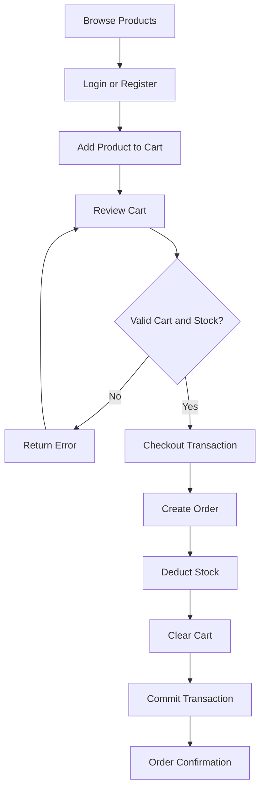

# GoShop — MVP Scope

## 1. Project Purpose

GoShop is a learning-oriented, single-store e-commerce application built with Go.

The main objective is to learn backend development by implementing the fundamental features of an online technology accessories store.

The project prioritizes simplicity, maintainability, security, and incremental development.

## 2. User Roles

### Guest

- Browse available products.
- Search and filter products.
- View product details.
- Register or log in.

### Customer

- Access guest functionality.
- Manage their shopping cart.
- Place simulated orders.
- View their own order history.
- Log out.

### Admin

- Create and update products.
- Manage product prices and stock.
- Activate or deactivate products.
- View all orders.
- Update order statuses.

## 3. Customer Flow

1. Browse available products.
2. Search or select a product.
3. Register or log in.
4. Add products to the shopping cart.
5. Review cart items and quantities.
6. Confirm checkout.
7. Receive an order confirmation.
8. View order history.

## 4. Admin Flow

1. Log in as an administrator.
2. Access the administration dashboard.
3. Create or update products.
4. Manage product prices and stock.
5. Review customer orders.
6. Update order statuses.

## 5. MVP Features

- Product catalog
- Product search and filtering
- Category management
- User registration and authentication
- Role-based authorization
- Shopping cart
- Inventory management
- Simulated checkout
- Order history
- Basic administration dashboard
- Simple web interface
- PostgreSQL persistence
- Automated testing

## 6. Out of Scope

- Real payment processing
- Credit card storage
- Shipping provider integration
- Multi-vendor marketplace
- Mobile applications
- Recommendation systems
- Microservices
- Advanced analytics

## 7. Core Domain Models

| Entity | Responsibility |
|---|---|
| User | Represents a customer or administrator. |
| Category | Organizes products into groups. |
| Product | Represents a product available in the store. |
| CartItem | Represents a product and quantity in a customer's cart. |
| Order | Represents a completed checkout transaction. |
| OrderItem | Stores purchased product details and quantities. |
| Session | Represents an authenticated user session. |

### Entity Relationships

- A category can contain multiple products.
- A user can have multiple cart items.
- A user can place multiple orders.
- A user can have multiple sessions.
- An order can contain multiple order items.
- A product can appear in multiple cart items.
- A product can appear in multiple order items.

## 8. Business Rules

- Product prices must be positive.
- Monetary values must be represented using integer minor currency units.
- Product stock cannot be negative.
- Cart item quantities must be positive integers.
- Inactive products cannot be purchased.
- Adding a product to the cart does not reserve stock.
- Stock must be validated before checkout.
- Insufficient stock must prevent order creation.
- Order creation and stock deduction must be atomic.
- Order items must preserve purchase-time prices.
- Customers can only access their own orders.
- Only administrators can manage products and orders.
- Passwords must be securely hashed.
- Checkout is simulated and does not charge real money.

## 9. Order Lifecycle

Pending → Preparing → Shipped → Delivered

Unsupported status transitions must be rejected.

## 10. Acceptance Scenarios

| Scenario | Expected Result |
|---|---|
| A guest browses products | Active products are displayed. |
| A customer registers with valid information | An account is created. |
| A customer provides invalid credentials | Login is rejected. |
| A customer adds an available product | The cart is updated. |
| A customer enters an invalid quantity | The operation is rejected. |
| A customer attempts to purchase an inactive product | The operation is rejected. |
| Available stock is insufficient | No order is created. |
| Checkout succeeds | An order is created and stock is reduced. |
| Checkout fails during processing | All partial changes are rolled back. |
| A customer requests another customer's order | Access is denied. |
| A customer attempts an admin operation | Access is denied. |
| An administrator updates product stock | The inventory is updated. |

## 11. Development Constraints

- Prefer the Go standard library where practical.
- Introduce external dependencies only when necessary.
- Keep the initial architecture simple.
- Implement and test features incrementally.
- Follow the GitHub Issues and milestone roadmap.
- Keep optional learning experiments separate from the core application.

## 12. Checkout Flow Diagram

